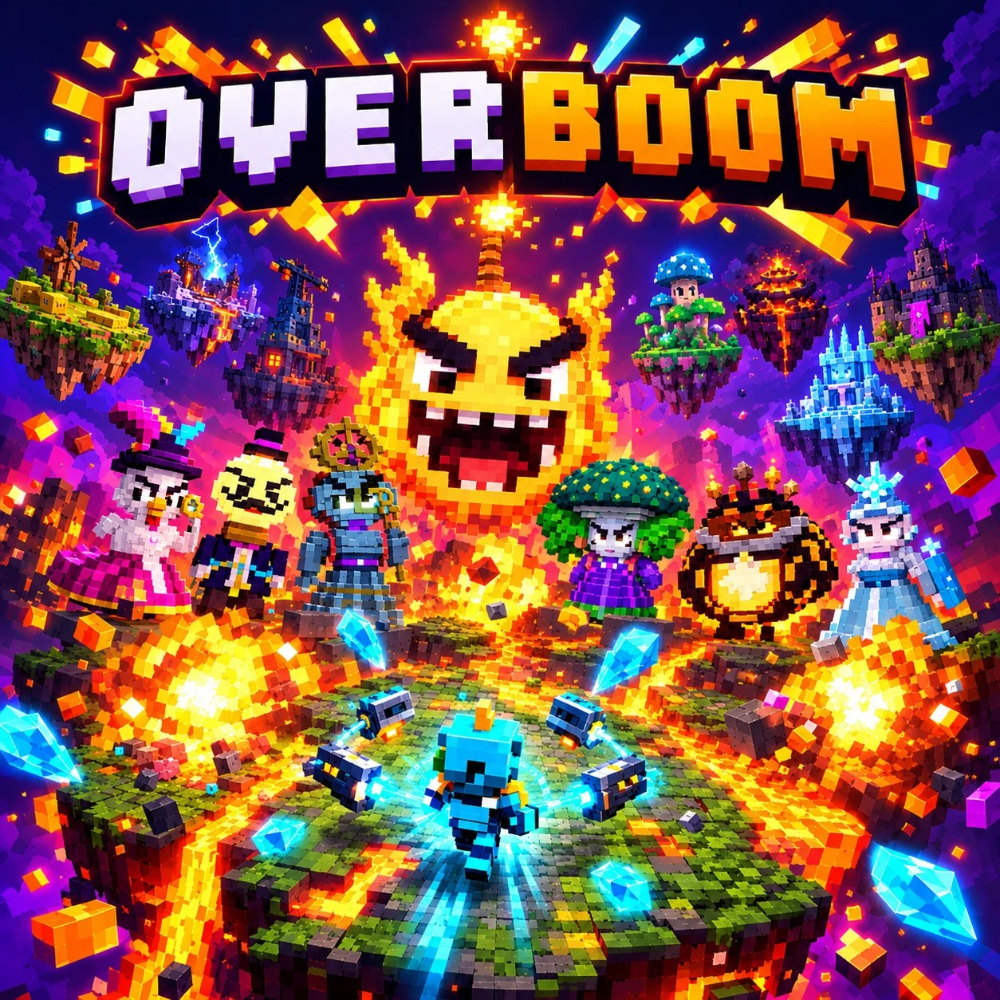
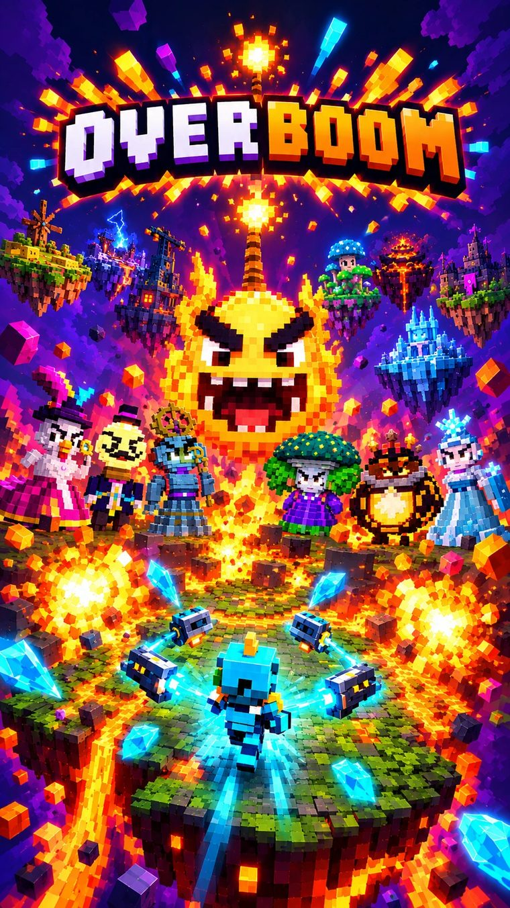

<p align="center"><a href="README.md">Deutsch</a> · <b>English</b></p>

<p align="center">
  <a href="https://hoai-droid.github.io/overboom/"></a>
</p>

<h3 align="center">Arena chaos with weapon fusion – solo or with up to four friends.</h3>

<p align="center">
  <a href="https://hoai-droid.github.io/overboom/"></a>
  <a href="#downloads"></a>
</p>
<p align="center">
  <a href="https://github.com/HOAI-droid/overboom/stargazers"></a>
  <a href="https://github.com/HOAI-droid/overboom/releases/latest"></a>
</p>

<p align="center"><b>Enjoying OVERBOOM? Give the project a ⭐ (top right) – it helps more people find it and keeps the development going!</b></p>

---



OVERBOOM is an action-packed arena roguelite in loud, colourful 3D voxel pixel art. You travel across floating islands, your weapons fire on their own, and after every wave you upgrade in the shop. At the **Fusion Anvil** you forge two or three weapons into a new one: projectile, propulsion and payload combine freely – more than 16,000 possibilities. Enemies are grumpy but cute, explosions set off chain reactions, and when the overkill bar is full, it's time for: **OVERBOOM!**

- 🏝️ **7 floating islands**, island bosses, 4 baronesses, 3 barons – and finally **the Great Kaboom**
- 🔨 **Weapon fusion** with more than 16,000 combinations and 40 secret recipes
- 💥 **Chain explosions** made of glowing voxels, finely detailed characters
- 👥 **Co-op for 1–4 players**, each on their own device
- 📱 Runs in the browser, on PC, Mac, Linux, Android, iPhone and Xbox
- 🎮 Touch, keyboard and controller · 🌍 English, Deutsch, Español, Français

<br clear="right">

## Downloads

Current version: **0.13.0**

**Play instantly in your browser:** <https://hoai-droid.github.io/overboom/> – on your phone use *Share → Add to Home Screen* (iPhone) or *Install app* (Android) to play full screen like an app; solo also works offline.

Or as an app – always the latest version, just click:

| Platform | Download | Note |
|---|---|---|
| **Windows** | [Installer (.exe)](https://github.com/HOAI-droid/overboom/releases/latest/download/OVERBOOM-Windows-Setup.exe) · [MSI](https://github.com/HOAI-droid/overboom/releases/latest/download/OVERBOOM-Windows.msi) | Unsigned: on the SmartScreen warning click “More info” → “Run anyway” |
| **Mac** | [App (.dmg)](https://github.com/HOAI-droid/overboom/releases/latest/download/OVERBOOM-Mac.dmg) | Apple Silicon and Intel. First launch: right-click → “Open” |
| **Linux** | [AppImage](https://github.com/HOAI-droid/overboom/releases/latest/download/OVERBOOM-Linux.AppImage) · [.deb](https://github.com/HOAI-droid/overboom/releases/latest/download/OVERBOOM-Linux.deb) · [.rpm](https://github.com/HOAI-droid/overboom/releases/latest/download/OVERBOOM-Linux.rpm) | AppImage: make executable and run |
| **Android** | [App (.apk)](https://github.com/HOAI-droid/overboom/releases/latest/download/OVERBOOM-Android.apk) | Open on your phone and allow “install unknown apps” |
| **iOS** | [App (.ipa, unsigned)](https://github.com/HOAI-droid/overboom/releases/latest/download/OVERBOOM-iOS-unsigniert.ipa) | Must be signed with your own Apple account (e.g. Xcode, AltStore, Sideloadly) |
| **Xbox Series X\|S** | [Package (.zip)](https://github.com/HOAI-droid/overboom/releases/latest/download/OVERBOOM-Xbox.zip) | Developer Mode only – guide (German): [docs/xbox.md](docs/xbox.md) |
| **Browser** | [Game as a single HTML file](https://github.com/HOAI-droid/overboom/releases/latest/download/OVERBOOM-Browser.html) | Download and open in your browser, works offline |

All versions and changes: [Releases](https://github.com/HOAI-droid/overboom/releases)

**Legal (German):** [Privacy](DATENSCHUTZ.md) · [License – all rights reserved](LICENSE) · [Third-party software](DRITTANBIETER.md)

The downloads are provided free of charge and without warranty. Solo play sends no data; for co-op, your IP address and player name go to the connection servers and your fellow players (details in the privacy notice).

## What to expect

- **A journey across 7 islands** of the world of Kaboomia – each with its own enemy faction, ground hazard, island boss and an island baroness or baron. Solo: 15 waves per island (progress is saved after every wave), co-op: 8. At the very end: the Great Kaboom in three phases.
- **Every arena is different:** pillars, crates, lava, poison and ice are placed anew for every run.
- **13 heroes**, each with their own starting weapon and quirk, unlocked through achievements.
- **60 weapons**, tiers I–V, stars, evolutions and 12 mods – plus **weapon fusion** and 40 secret recipes.
- **159 items** and **equipment** with 8 slots and 4 sets.
- **9 elements** with synergies and 15 elemental reactions (steam explosion, shock frost, plasma burn …).
- **Co-op for 1–4 players**, each on their own device: create a room, share the code or QR code, play. Fallen teammates can be revived.
- **Card album** with 292 cards, shiny cards and achievements – every card can be saved as an image.
- **Danger levels 0–10** for everyone who finds it too easy.
- **Music that plays along:** deliberately simple, generated live, choose rock, pop, retro (8/16 bit) or chiptune; it follows the action.
- **Four languages:** English, German, Spanish, French – asked on first launch, changeable in the settings.
- Graphics from “Low” to “Max” (double resolution); finely detailed characters from “Ultra”. Accessibility settings (screen shake, flashes, colour-blind mode).

## Controls

| | Keyboard | Controller | Touch |
|---|---|---|---|
| Move | WASD / arrows | left stick | left thumb |
| Dash | Space / Shift | A / RB | dash button |
| OVERBOOM | E / Q | Y / X | OVERBOOM button |
| Pause | Esc / P | menu button (☰) | ❚❚ |

Aiming and shooting are automatic. All menus work with mouse, touch, keyboard or controller.

## Tested on

Android phones, iPhone (simulator), Xbox Series X|S, PC and Mac in the browser; co-op between devices on the same Wi-Fi.

## Known issues

- Co-op between devices on the same network (Wi-Fi) works. Across different networks (e.g. mobile data) it is not tested yet; without a TURN relay co-op does not work on every network.
- No host migration: if the host leaves, the game ends for everyone (with a notice).
- Enemies walk straight at the player (no flow field yet); they slide sideways around pillars.
- Island bosses repeat during the journey (4 boss models for 7 islands); every island has its own baroness or baron, though.
- The apps are unsigned (Windows SmartScreen, Mac Gatekeeper, iOS must be signed by yourself).

## For developers

Monorepo with TypeScript, Three.js and Vite. The simulation (`packages/core`) is deterministic and also runs in Node; rendering, UI, networking (host-authoritative co-op over WebRTC), audio and platform access are separate packages. Code comments and the detailed docs are in German: [CLAUDE.md](CLAUDE.md), [docs/OVERBOOM_Prompt.md](docs/OVERBOOM_Prompt.md).

Every push to `main` publishes the web build on GitHub Pages (`pages.yml`) and builds all apps as release `v<version from package.json>` (`release.yml`).

```bash
npm install
npm run dev            # dev server (reachable on your Wi-Fi → test on a phone)
npm test               # simulation, network and audio tests (Node 22+)
npm run balance        # balancing bot plays full runs
npm run typecheck
npm run build:web      # static build in dist/
npm run build:single   # everything in one HTML file
npm run dev:desktop    # desktop app (Tauri) in dev mode
npm run build:desktop  # build desktop app
npm run build:mobile   # web build + Capacitor sync (then npm run android / npm run ios)
npm run build:xbox     # copy web build into the Xbox app
```

## What's new

### 0.13.0 – finer and louder
- **Finely detailed models** for all heroes, enemies and bosses from graphics level “Ultra”. On PC and Xbox, “Auto” now starts at “Ultra”.
- **New voxel explosions:** a glowing ball of voxels turns from white through yellow and orange to red, swells, breaks apart and throws glowing chunks; then some smoke drifts away. Three sizes; with many explosions at once they automatically get leaner so the screen stays readable.
- Extra front light; your hero stays visible as a silhouette behind walls.
- The world map names the baroness or baron you still have to beat.

### 0.12 – the great journey
- A run now leads from your starting island all the way to Boomburg, with island bosses, 4 baronesses, 3 barons and the finale against the Great Kaboom. Continue (solo), random arenas, new balancing and card interface.

Full version history (German): [README.md](README.md#versionsgeschichte)
