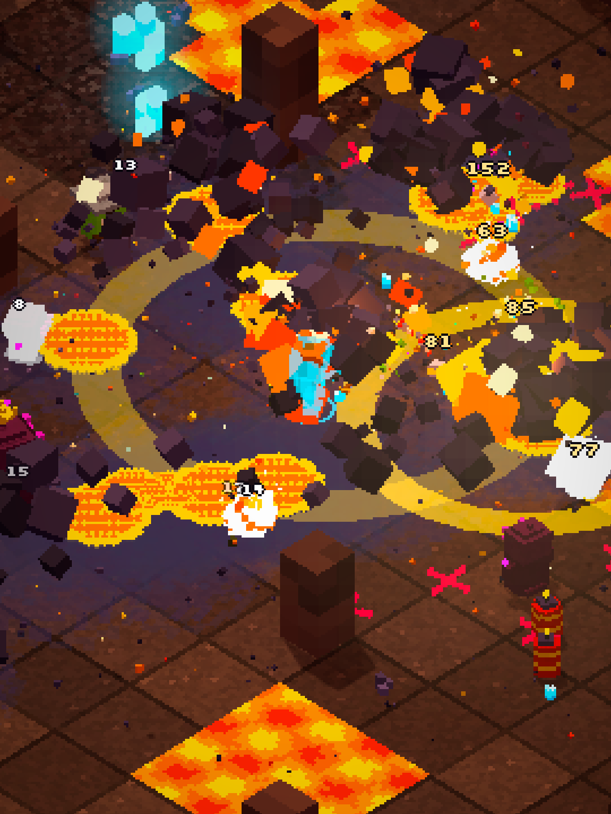
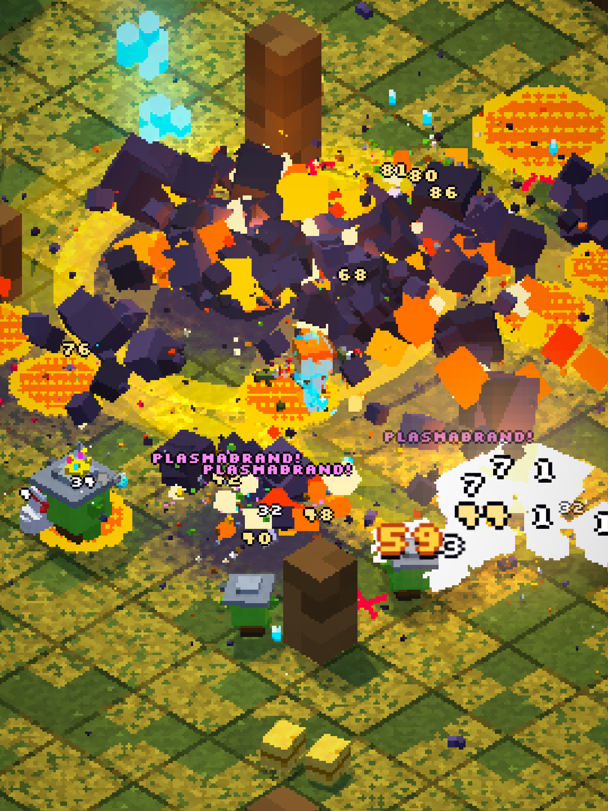

# OVERBOOM

**Arena-Chaos mit Waffen-Fusion – allein oder mit bis zu vier Leuten.**

OVERBOOM ist ein actiongeladenes Arena-Roguelite in knalliger 3D-Voxel-Pixel-Optik. Du läufst über schwebende Inseln, deine Waffen feuern von selbst, und nach jeder Welle rüstest du im Shop auf. Aus zwei oder drei Waffen schmiedest du am **Fusions-Amboss** neue: Geschoss, Antrieb und Ladung lassen sich frei kombinieren – über 16.000 Möglichkeiten, von der *Gackernden Blitzrakete* bis zum *Rollenden Kükenbumerang*. Gegner sind grimmig, aber knuffig, Explosionen lösen Kettenreaktionen aus, und wenn die Overkill-Leiste voll ist, heißt es: **OVERBOOM!**

<p align="center">
  
  
</p>

## Downloads (Version 0.10.1)

**Sofort im Browser spielen:** <https://hoai-droid.github.io/overboom/> – am Handy über *Teilen → Zum Home-Bildschirm* (iPhone) bzw. *App installieren* (Android) wie eine App im Vollbild, solo auch offline.

Oder als App – immer die neueste Version, einfach anklicken:

| Plattform | Download | Hinweis |
|---|---|---|
| **Windows** | [Installer (.exe)](https://github.com/HOAI-droid/overboom/releases/latest/download/OVERBOOM-Windows-Setup.exe) · [MSI](https://github.com/HOAI-droid/overboom/releases/latest/download/OVERBOOM-Windows.msi) | Unsigniert: bei der SmartScreen-Warnung „Weitere Informationen“ → „Trotzdem ausführen“ |
| **Mac** | [App (.dmg)](https://github.com/HOAI-droid/overboom/releases/latest/download/OVERBOOM-Mac.dmg) | Apple Silicon und Intel. Beim ersten Start: Rechtsklick → „Öffnen“ |
| **Linux** | [AppImage](https://github.com/HOAI-droid/overboom/releases/latest/download/OVERBOOM-Linux.AppImage) · [.deb](https://github.com/HOAI-droid/overboom/releases/latest/download/OVERBOOM-Linux.deb) · [.rpm](https://github.com/HOAI-droid/overboom/releases/latest/download/OVERBOOM-Linux.rpm) | AppImage: ausführbar machen und starten |
| **Android** | [App (.apk)](https://github.com/HOAI-droid/overboom/releases/latest/download/OVERBOOM-Android.apk) | Am Handy öffnen und „Installation aus unbekannten Quellen“ erlauben |
| **iOS** | [App (.ipa, unsigniert)](https://github.com/HOAI-droid/overboom/releases/latest/download/OVERBOOM-iOS-unsigniert.ipa) | Muss mit eigenem Apple-Konto signiert werden (z. B. Xcode, AltStore, Sideloadly) |
| **Xbox Series X\|S** | [Paket (.zip)](https://github.com/HOAI-droid/overboom/releases/latest/download/OVERBOOM-Xbox.zip) | Nur im Developer Mode – Anleitung: [docs/xbox.md](docs/xbox.md) |
| **Browser** | [Spiel als eine HTML-Datei](https://github.com/HOAI-droid/overboom/releases/latest/download/OVERBOOM-Browser.html) | Herunterladen und im Browser öffnen, läuft offline |

Alle Versionen und Änderungen: [Releases](https://github.com/HOAI-droid/overboom/releases)

**Rechtliches:** [Datenschutz](DATENSCHUTZ.md) · [Lizenz – alle Rechte vorbehalten](LICENSE) · [Drittanbieter-Software](DRITTANBIETER.md)

Die Downloads werden kostenlos und ohne Gewähr bereitgestellt. Solo werden keine Daten übertragen; für Koop gehen IP-Adresse und Spielername an Verbindungsserver und Mitspieler (Details im Datenschutzhinweis).

## Was dich erwartet

- **20 Wellen pro Run** auf **7 Inseln** der Welt Krawummia – jede mit eigener Gegner-Fraktion, Bodengefahr und Boss. Am Ende wartet der Baron von Bumm.
- **13 Helden** mit eigener Startwaffe und Macke, über Erfolge freischaltbar.
- **60 Waffen**, Stufen I–V, Sterne, Evolutionen und 12 Mods – plus **Waffen-Fusion** und 40 geheime Rezepte.
- **159 Items** und **Ausrüstung** mit 8 Plätzen und 4 Sets.
- **9 Elemente** mit Synergien und 15 Elementar-Reaktionen (Dampfexplosion, Schockfrost, Plasmabrand …).
- **Koop für 1–4 Spieler**, jeder am eigenen Gerät: Raum erstellen, Code oder QR-Code teilen, losspielen. Gefallene Mitspieler werden wiederbelebt.
- **Sammelkartenalbum** mit 292 Karten, Glanzkarten und Erfolgen – jede Karte auch als Bild speicherbar.
- **Gefahrenstufen 0–10** für alle, denen es zu leicht wird.
- **Musik, die mitspielt:** wird live erzeugt, wählbar als Rock, Pop, Retro (8/16 Bit) oder Chiptune, und passt sich dem Kampfgeschehen an.
- Grafik von „Niedrig“ bis „Max“ (doppelte Auflösung), Einstellungen für Barrierefreiheit (Wackeln, Lichtblitze, Farbenblind-Modus).

## Steuerung

| | Tastatur | Controller | Touch |
|---|---|---|---|
| Laufen | WASD / Pfeile | linker Stick | linker Daumen |
| Dash | Leertaste / Shift | A / RB | Dash-Knopf |
| OVERBOOM | E / Q | Y / X | OVERBOOM-Knopf |
| Pause | Esc / P | Menü-Taste (☰) | ❚❚ |

Gezielt und geschossen wird automatisch. Menüs gehen komplett mit Maus, Touch, Tastatur oder Controller.

## Für Entwickler

Monorepo mit TypeScript, Three.js und Vite. Die Simulation (`packages/core`) ist deterministisch und läuft auch in Node; Rendering, UI, Netz (Host-autoritativer Koop über WebRTC), Audio und Plattform-Zugriffe sind eigene Pakete. Details: [CLAUDE.md](CLAUDE.md), Spezifikation: [docs/OVERBOOM_Prompt.md](docs/OVERBOOM_Prompt.md), Waffen: [docs/Waffenkatalog.md](docs/Waffenkatalog.md).

**Browser-Version:** Jeder Push auf `main` veröffentlicht den Web-Build auf GitHub Pages (`pages.yml`).

**Releases:** Jeder Push auf `main` baut per GitHub Actions (`release.yml`) alle Apps und legt sie als Release `v<Version aus package.json>` mit festen Dateinamen ab – die Download-Links oben zeigen immer auf den neuesten Stand. Für eine neue Version die Versionsnummer in `package.json` erhöhen.

### Befehle
```bash
npm install
npm run dev            # Entwicklungsserver (auch im WLAN erreichbar → Handy testen)
npm test               # Simulations-, Netz- und Audio-Tests (Node 22+)
npm run balance        # Balancing-Bot spielt komplette Runs
npm run typecheck
npm run build:web      # statischer Build in dist/
npm run build:single   # alles in einer HTML-Datei
npm run dev:desktop    # Desktop-App (Tauri) im Entwicklungsmodus
npm run build:desktop  # Desktop-App bauen
npm run build:mobile   # Web-Build + Capacitor-Sync (dann npm run android / npm run ios)
npm run build:xbox     # Web-Build in die Xbox-App kopieren
```

URL-Parameter: `?res=360` (Auflösung), `?seed=42` (Arena), `?shadows=0` (Schatten aus), `?shake=0` (Screen-Shake aus, 0–2), `?zahlen=0` (Schadenszahlen aus), `?raum=CODE` (Koop-Raum beitreten), `?netz=lokal` (Koop zwischen Browser-Tabs statt WebRTC).
Debug: `?wave=10` (Startwelle, 10 = Boss), `?god=1` (unverwundbar), `?gems=500` (Startkristalle), `?waffen=huehnerkanone,huehnerkanone,huehnerkanone` (Startwaffen, überspringt die Wahl), `?held=pyromane&insel=lavakessel` (Schnellstart), `?galerie=1` (alle Gegner zum Anschauen), `?beute=6` (Ausrüstung in den Beutel), `?alles=1` (alle Karten, Inseln und Gefahrenstufen freischalten), `?test=1` (Zustand für automatische Browser-Tests lesbar).


## Bekannte Probleme
- **Koop über echtes WebRTC ist noch nicht zwischen zwei Geräten getestet** – in der Entwicklungsumgebung sind die öffentlichen Nostr-Relays gesperrt. Getestet sind Netzcode (Node-Tests) und Koop zwischen Browser-Tabs (`?netz=lokal`). Ohne TURN-Relay klappt Koop nicht in jedem Netz.
- Keine Host-Migration: Verlässt der Host das Spiel, endet es für alle (mit Hinweis).
- Ein Host-Tab im Hintergrund läuft über den Worker-Takt weiter, Browser können ihn aber nach einer Weile drosseln. Am besten bleibt der Host im Vordergrund.
- Snapshots haben noch keine Delta-Kompression; bei sehr vielen Geschossen werden sie größer (gemessen ~1,5 KB, im Extremfall bis ~20 KB).
- Gegner laufen direkt auf den Spieler zu (noch kein Flow-Field); an Säulen rutschen sie seitlich ab.
- Balancing grob: Der Balancing-Bot stirbt oft früh, gute Runs gewinnen. Er nutzt weder Mods, Ausrüstung, Evolutionen noch den OVERBOOM-Modus. Koop- und Gefahren-Werte (`KOOP`, `data/src/danger.ts`) sind Schätzungen.
- Fusions-Vorschau am Trainings-Dummy (10 s testen) fehlt noch; Fusionen aus Fusionen sind bewusst nicht möglich.
- Musik ist bewusst schlicht (prozedurale Loops); Soundeffekte sind synthetisch.
- Auf echten Handys und der Xbox noch nicht gemessen (nur Headless-Chromium mit Software-Rendering getestet).
- Apps sind unsigniert (Windows SmartScreen, Mac Gatekeeper, iOS muss selbst signiert werden).

## Nächster Schritt
Phase 10: Tests auf echten Geräten (Handy, Xbox, Koop über Mobilfunk), Signaturen und Store-Einträge.

## Versionsgeschichte

### Version 0.10.1 – Koop repariert
- Koop-Synchronisierung: Trystero liefert Binärdaten als `Uint8Array`-Ausschnitt; der Snapshot-Decoder erwartete einen `ArrayBuffer` und brach ab. `Reader` nimmt jetzt beides, der Test-Transport bildet das Trystero-Verhalten nach. Snapshots bleiben unter 16 KB (`SNAPSHOT_MAX`, gestufte Kürzung unwichtiger Teile).
- „Beenden“ / „Raum verlassen“ in Shop, Level-Up und Pause (mit Rückfrage).
- Kristalle: Tempo begrenzt und im Spielfeld gehalten (Test).
- Klippen am Rand stechen nicht mehr durch den Boden (kein Flackern).
- Balancing-Mittelweg: frühe Wellen wie 0.9, späte etwas milder als 0.10.0, Waffen-Grundschaden wieder 100 %.

### Version 0.10.0 – Musik, schärfere Grafik und mehr Herausforderung
- **Prozedurale Musik** (`packages/audio`):
  - `komponist.ts` erzeugt endlose Musik aus Bausteinen (Abschnitte, Akkordfolgen, Grooves, Riffs, Motive) mit drei Intensitätsstufen.
  - `band.ts` spielt sie mit WebAudio-Instrumenten (verzerrte Gitarre, Synth, Pulswellen, Rauschen) – ohne eine einzige Audiodatei (~25 KB Code).
  - Stile: Rock, Pop, Retro, Chiptune oder aus.
  - Die Intensität folgt Gegnerzahl, Explosionen und OVERBOOM-Modus; bei großen Explosionen duckt sich die Musik kurz.
- **Grafik:** neue Stufen „Ultra“ (405 px) und „Max“ (540 px kurze Seite). „Automatisch“ steigt bei flüssigen 60 fps bis „Ultra“.
- **Balancing:**
  - Ab Welle 9 steigen Gegnerleben und -schaden stärker, ab Welle 11 kommen mehr Gegner, mehr Elite-Gegner.
  - Waffen −5 %, flachere Stufen, Lebensraub max. 3/s.
  - Der Balancing-Bot (`npm run balance`) misst jetzt das tiefste Leben ab Welle 11: vorher immer über 75 %, jetzt typischerweise um 50 %, und rund 30 % der starken Runs scheitern zwischen Welle 12 und 19.
- **Explosionsgrafik 20 % kleiner** (Wirkung unverändert).
- **Datenschutz & Lizenzen im Spiel** (Einstellungen) und einmaliger Hinweis vor dem ersten Koop-Raum.

### Phase 9 – Apps für alle Plattformen (v0.9.0)

Alle Apps bauen sich per GitHub Actions. Jeder Stand auf `main` landet automatisch als Release mit festen Dateinamen (siehe Downloads oben); Zwischenstände der Entwicklungszweige liegen als Artefakt am jeweiligen Lauf.

| Plattform | Technik | Workflow | Ergebnis |
|---|---|---|---|
| Windows | Tauri 2 (`apps/desktop`) | `desktop.yml` | Installer `.exe` (NSIS) + `.msi` |
| Mac | Tauri 2 | `desktop.yml` | Universal-`.dmg` (Apple Silicon + Intel), ad-hoc signiert |
| Linux | Tauri 2 | `desktop.yml` | `.AppImage`, `.deb`, `.rpm` |
| Android | Capacitor 8 (`apps/mobile`) | `mobile.yml` | Debug-`.apk` zum direkten Installieren, `.aab` für Google Play |
| iOS | Capacitor 8 | `mobile.yml` | Simulator-App + unsignierte `.ipa` (signieren mit eigenem Apple-Konto) |
| Xbox Series X\|S | UWP + WebView2 (`apps/xbox`) | `xbox.yml` | `.msix` + Dependencies + Testzertifikat (Dev Mode) – Anleitung: [docs/xbox.md](docs/xbox.md) |

- **Plattform-Schicht** (`packages/platform`): `createPlatform()` wählt Xbox → Capacitor → Tauri → Web. Speichern, Vibration, Teilen und Bild-Export laufen je Plattform nativ (Tauri: Downloads\OVERBOOM, Handy: Teilen-Menü, Xbox: Bilder\OVERBOOM).
- **Handy**: nur Querformat, echtes Vollbild, Bildschirm bleibt an, Pixel-Bombe als Icon und Splash. Schrift liegt lokal (offline).
- **Xbox**: komplette Menüsteuerung per Controller (Steuerkreuz/Stick + A/B, sichtbarer Fokus, Regler mit ◀ ▶, Textfelder mit A), Controller-Symbole statt Tastatur-Hinweisen, B = Zurück, Beenden im Titelmenü, TV-sichere Ränder, Qualität konservativ, Speicher-Wächter. Im Browser testbar mit `?plattform=xbox`.
- **Signieren**: Android-Release über Umgebungsvariablen/Secrets `OVERBOOM_KEYSTORE(_B64)`, `OVERBOOM_KEYSTORE_PASS`, `OVERBOOM_KEY_ALIAS`, `OVERBOOM_KEY_PASS` (Keystore nie einchecken). Windows/Mac sind unsigniert (SmartScreen: „Weitere Informationen" → „Trotzdem ausführen"; Mac: Rechtsklick → Öffnen).
- Befehle: `npm run dev:desktop`, `npm run build:desktop`, `npm run build:mobile` (Web-Build + `cap sync`), `npm run android` / `npm run ios` (öffnet Android Studio/Xcode), `npm run build:xbox` (Web-Build → `apps/xbox/OverboomXbox/Web`).
- Werbegrafik (Hochformat 1080×1920): `docs/werbung/`.

### Phase 7 + 8 – Koop & Feinschliff (v0.8.0)

#### Koop (1–4 Spieler, jeder am eigenen Gerät)
- **Titelbildschirm**: Solo spielen, Raum erstellen oder mit Code beitreten. Einladungslink `?raum=CODE` tritt direkt bei.
- **Lobby** mit 6-stelligem Raumcode, QR-Code, „Link teilen", Spielerliste mit Verbindungsart (direkt / über Relay) und Ping, Heldenwahl für jeden, Insel und Gefahrenstufe vom Host. Start, sobald alle bereit sind.
- **Host-autoritativ**: Das Gerät des Hosts simuliert für alle mit 30 Hz (auch kurz im Hintergrund über einen Worker-Takt). Clients schicken nur Eingaben und Shop-Befehle.
- **Netzcode** (`packages/net`): binäre, quantisierte Snapshots (~1,5 KB, 15 Hz) mit den Ereignissen dazwischen – Effekte entstehen bei jedem lokal. Inventar/Shop als JSON nur bei Änderung. Eigene Figur wird vorhergesagt und abgeglichen, alles andere 100 ms verzögert interpoliert.
- **Koop-Regeln**: gemeinsame Welle, eigener Shop (weiter, wenn alle bereit sind), Gegnerleben/-anzahl/Boss skalieren mit Spielerzahl, **Niederschlagen + Revive-Ring** (2,5 s danebenstehen), am Wellenende stehen alle wieder auf.
- Namensschilder, Pfeile zu Mitspielern außerhalb des Bildes, leichter Koop-Kamerazoom, Wiederverbinden innerhalb von 30 s, sauberer Abbruch mit Hinweis.
- **Transport**: WebRTC über Trystero (Signaling über Nostr), STUN eingebaut, **TURN** konfigurierbar (siehe unten). Zum Testen ohne Netz: `?netz=lokal` (Koop zwischen Browser-Tabs).

#### Feinschliff und Meta-Progression
- **Audio** (`packages/audio`): 45 prozedurale Soundeffekte (eigener Retro-Klanggenerator, keine Dateien) – jede Waffe klingt nach Geschoss/Gruppe (Gacker, Kazoo, Raketen, Blitze …), Ketten-Explosionen steigen in der Tonhöhe, Kristalle spielen eine Tonleiter; 4 Chiptune-Loops (Menü, Kampf, Boss, Shop); Stereo nach Position.
- **Overkill-Leiste & OVERBOOM-Modus**: füllt sich durch Kills und Ketten; auslösen (E/Q, Gamepad Y, Touch-Knopf) → 5 s doppelte Feuerrate, jeder Treffer explodiert, Bildschirm färbt sich.
- **Gefahrenstufen 0–10** mit aufsteigenden Modifikatoren (bis „OVERBOOM": alle Gegner explodieren beim Tod). Ein Sieg schaltet die nächste Stufe frei.
- **9 Helden** werden über Erfolge freigeschaltet; 20 Erfolge insgesamt.
- **Einstellungen**: Lautstärken, Qualität (automatisch nach Bildrate oder fest), Bildschirm-Wackeln, Lichtblitze, Partikeldichte, Schadenszahlen, Vibration, **Farbenblind-Modus** (gemusterte Gefahrenzonen) – gespeichert.
- **PWA**: installierbar (Manifest, Icons), Service Worker → solo offline spielbar. Spielstand in **IndexedDB** (alter Stand wird übernommen) plus Export-Code.
- **Debug-Menü**: F1 oder 5-Finger-Tipp (Kristalle, Welle überspringen, Gott-Modus, Waffen/Gegner spawnen).
- UI-Animationen (Panels ploppen schräg herein, Knöpfe federn; „reduzierte Bewegung" wird respektiert), Tipps und Sprüche.

#### Koop über das Internet: TURN einrichten
Direkte Verbindungen klappen in vielen WLANs. In Mobilfunk- oder Firmennetzen braucht es einen TURN-Relay. Beim Build als Umgebungsvariablen setzen (z. B. Cloudflare Realtime TURN oder eigener coturn):
```bash
VITE_TURN_URLS="turn:turn.example.com:3478,turns:turn.example.com:5349" VITE_TURN_USER="name" VITE_TURN_PASS="geheim" npm run build:web
```

### Phase 6 – Welt & Karten (v0.6.0)
- **Weltkarte Krawummia**: schwebende Voxel-Inseln über einem Wolkenmeer, jede mit eigener Deko (Scheune, Tesla-Türme, Fabrik, Riesenpilze, Vulkan, Eiskristalle, Bummburg). Ablauf: Held wählen → Insel auf der Karte wählen → los.
- **Insel-Freischaltung**: Am Anfang ist nur Gackerfeld offen. Wer den Insel-Boss (Welle 10) besiegt, befreit die Insel (Flagge) und schaltet die nächste frei; ein Sieg auf Welle 20 erobert sie (Krone).
- **Kartenalbum** (Set „Das Große Kawumm", 292 Karten): alle Helden, Waffen, 40 Rezepte, Gegner, Bosse und Items. Jede Karte mit Name, Element-Symbolen, Hauptwert (Wucht/HP/Preis), live gerendertem und drehendem Voxel-Artwork, Typzeile, Fähigkeiten, Flavor-Text mit Zitat, Seltenheit und Kartennummer.
- **Freischalten nur durchs Spielen**: Waffe benutzt, Held gespielt, Item gekauft, 50 Gegner besiegt, Boss besiegt, Rezept entdeckt. Gesperrte Karten zeigen eine Silhouette und wie man sie bekommt.
- **Glanzkarten** mit holografischem Schimmer (folgt dem Zeiger): z. B. Waffe auf 5 Sterne, Sieg mit dem Helden, 500 Gegner einer Art – und über **18 Erfolge**.
- **Karten als Bild** speichern bzw. am Handy teilen (PNG mit Rahmen).
- **Rezeptbuch** im Album: 40 geheime Rezepte (30 neu), unentdeckte mit Hinweis. Neue Rezept-Wirkungen: Mini-Bumm, Feuerspur, Frostnova, Goldregen, Donnerschlag.
- **Lore** (`data/lore.ts`): Weltgeschichte, Ankunfts- und Befreiungstexte je Insel, Boss-Auftritte, Wellen- und Todessprüche, Karten-Zitate.
- **Spielstand**: Profil wird auf dem Gerät gespeichert; Export/Import als Code (Album → Erfolge). Meldungen für neue Karten, Glanzkarten, Erfolge und Inseln.

### Phase 5 – Content-Ausbau (v0.5.0)
- **13 Helden** mit Startwaffe, Werten und Macke (z. B. Pyromane bekommt nur Explosiv/Feuer, Glückspilz startet mit Zufallswaffe, Oma Kawumm verteilt Heil-Kekse, Turmbauer darf 2 Türme). Start: Held wählen → Insel wählen.
- **7 Inseln** mit eigener Gegner-Fraktion, Farbpalette, Bodengefahr (Eis rutscht, Gift, Tesla-Platten, Lava, brennendes Heu …) und Boss auf Welle 10; Welle 20 immer Baron von Bumm.
- **16 Gegnertypen + 4 Bosse** mit neuen Verhalten: Sprinter, Heiler, Schildträger, Minenleger, Spurleger, Beschwörer, Rutscher, Splitter (Schleimi teilt sich). Bosse König Gockel, Megatoaster, Morchella mit wechselnden Angriffsmustern.
- **Synergien**: 9 Elemente, Boni ab 2/4/6 Waffen gleichen Elements (Feuerpfützen, Mini-Nuke, Gewitter, Giftwolken, Drohnen, Küken, Eierregen …). Anzeige im Shop und als Chips im HUD.
- **15 Elementar-Reaktionen** (Dampfexplosion, Schockfrost, Plasmabrand, Sumpf, Strudel …), wenn zwei Elemente denselben Gegner treffen.
- **Sterne & Evolutionen**: Waffen sammeln Kills (★1–5, je Stern mehr Schaden/Feuerrate); mit 5 Sternen Evolution A „Mehr" (Salven) oder B „Größer" (2,4× Schaden), mit eigenen Namen (Schwarmraketen/Atomrakete, Doppelpistolen/Handkanone …).
- **12 Waffen-Mods** (Doppelschuss, Querschläger, Zielsuch-Chip, Clusterbombe, Kettenblitz, Gravitations-Kern …), im Shop kaufbar, Einbau ab Stufe II (II: 1 Slot … V: 4).
- **159 Items** (vorher 24), viele mit Vor- und Nachteil.
- **Ausrüstung**: 8 Plätze (Helm, Rüstung, Stiefel, Handschuhe, Amulett, 2 Ringe, Rucksack), Seltenheit I–IV mit zufälligen Zusatzwerten, **4 Sets** (Grummel-Garnitur, Barons Gala-Garderobe, Funkenkluft, Omas Strickset) mit Boni ab 2 Teilen bzw. komplett. Quellen: Elite-Gegner (30 %), Bosse (immer, oft Set-Teile), Shop. Shop-Tab „Ausrüstung": anlegen, ablegen, verschrotten.
- Tests: alle Reaktionen, Synergie-Stufen, Helden, Inseln, Bosse, Sterne, Evolution, Mods, Ausrüstung und Sets.

### Phase 4 – Waffen-Fusion
- **Fusions-Amboss** im Shop (Tab „⚒ Amboss"): 2–3 Waffen aus verschiedenen Gruppen wählen, dann festlegen, welche Waffe **Geschoss**, **Antrieb** und **Ladung** liefert (jede mindestens eins). Live-Vorschau mit Name, Werten, Elementen und Instabilität; Schmiedelohn steigt mit der Welle.
- **Systemisch**: Jede der ~16.700 Kombinationen funktioniert. Dafür simuliert der Kern jetzt **alle 19 Antriebe** (u. a. Kreisel, Querschläger, Bumerang, Spirale, Strahl, Kegel, Himmelsregen, Hüpfen, Minen, Türme, Schwarm-Begleiter, Rollen, Teleport, Rundumschlag) und **alle 22 Ladungen** (u. a. Küken-Begleiter, Verhühnerung, Lavapfützen, Nässe leitet Blitze doppelt weit, Säure, Magnet, Schwerkraft-Sog, Konfetti-Verwirrung, Einfrieren nach 3 Frost-Treffern). Dadurch sind auch **alle 60 Waffen im Shop**.
- **Werte**: Feuerrate und Reichweite vom Antriebs-Spender, Schaden so, dass der DPS dem Mittel der Zutaten entspricht – plus Bonus je nach **Instabilität** (0–100 %: je verschiedener die Gruppen, desto instabiler und stärker). Bei Krit kann eine instabile Waffe einen Bonus-„Kawumm!" auslösen (nie schädlich für dich).
- **Namensgenerator** (Adjektiv vom Geschoss + Element der Ladung + Nomen vom Antrieb, Endung nach Genus): „Gackernde Blitzrakete", „Rollender Kükenbumerang" …
- **Zusammengesteckte Voxel-Modelle**: Körper vom Antriebs-Spender, Aufsatz = Geschoss, Leuchtkern in Ladungsfarbe, Funken je nach Instabilität.
- **10 geheime Rezepte** mit eigenem Namen, Effekt und Modell, z. B. 3× Hühnerkanone = **HUHNAGEDDON** (Riesenhuhn, Eier-Bombenregen), Kawummageddon (Cluster-Explosionen), Donnertoaster, Schwarzes Buffet (Sog + Implosion), Omas Geheimrezept (heilende Kekse), Quietschendes Inferno, Frostfeuerwerk, Kettensägen-Karussell, Bienenkönigin (Giftwolken), Gackerndes Chaos (Verhühnerungs-Strahl). Beim ersten Entdecken: Fanfare + „Rezept entdeckt!".
- **Rezeptbuch** im Amboss: entdeckte Rezepte mit Zutaten, unentdeckte als „???" mit Hinweis (auf dem Gerät gespeichert).
- Fusionen lassen sich wie normale Waffen mergen, verkaufen und aufwerten.
- Tests: alle 418 Antrieb×Ladung-Kombinationen, 300 Zufallsfusionen, alle 60 Waffen und alle 10 Rezepte kämpfen ohne Fehler und machen Schaden.

### Phase 3 – Shop & Progression
- **Run-Ablauf**: Startwaffe wählen (Pistole, Raketenwerfer, Tesla-Stab, Schrotflinte) → 20 Wellen → Sieg (optional Endlos weiter) oder Niederlage. Nach jeder Welle: Level-Up-Wahl, dann Shop.
- **Level-Up**: Kristalle sind Währung *und* XP (Bedarf (Level+3)²). Pro Level 1 aus 4 Verbesserungen in 4 Seltenheiten; 14 Werte (Schaden, Feuerrate, Krit, Reichweite, Rüstung, Ausweichen, Regeneration, Lebensraub, Tempo, Glück, Ernte, Explosionsradius, Sammelradius, Max-Leben).
- **Shop**: 4 Angebote (Waffen + 24 Items mit Vor- und Nachteilen), Neu würfeln (Preis steigt), Sperren, Verkaufen, **Merge** (2 gleiche Waffen gleicher Stufe → nächste Stufe I–V, auch automatisch beim Kauf ohne freien Platz), bis zu 6 Waffen, Werte-Übersicht. 22 Waffen kaufbar – alle, deren Antrieb schon simuliert wird.
- **Neue Ladungen**: Durchschlag (Plasma), Frost/Kleister (verlangsamt), Brand/Gift (Schaden über Zeit), Splitter, Schwerkraft/Magnet (zieht zusammen), Schall/Ranken/Konfetti (betäubt, mit Sternchen), Glück (doppelte Kristalle), Lebensraub. Neuer Antrieb: Bogenwurf.
- **Boss Baron von Bumm** auf Welle 10 und 20: Bomben-Salven mit roten Einschlag-Markierungen, ab 50 % Leben Phase 2 (größere Salven, ruft Bomben-Kröten). Boss-Wellen enden mit seinem Tod, Boss-Leiste im HUD.
- **Elite-Gegner** ab Welle 5: größer, mit Krone, 5× Leben, 6× Kristalle.
- **Run-Ende** mit Statistik: Welle, Level, Besiegt, Gesamtschaden, größte Kette, Kristalle, MVP-Waffe. Pause-Menü (Esc/P/Start, automatisch im Hintergrund).
- **Menüs** komplett mit Touch, Maus, Tastatur (Pfeile + Enter, Esc) und Gamepad (Steuerkreuz + A/B).
- Alles läuft über Befehle (`world.command(...)`) – vorbereitet für Host-autoritativen Koop. Shop hat einen eigenen Zufallsgenerator.
- Balancing-Bot: `npm run balance` spielt komplette Runs und gibt Welle/Level/Ketten aus.

### Phase 2 – Kampf-Kern
- 3 Waffen mit Auto-Aim (systemisch aus Antrieb + Ladung), Grummelbold, Bomben-Kröte, Toastomat, Wellen mit Spawn-Warnung, Kristalle, Ketten-Explosionen, Fässer, Hit-Stop, Screen-Shake, Schadenszahlen. Instancing, Pools, Spatial Hash.
- Phase 1: Monorepo, deterministische 30-Hz-Simulation, Low-Res-Voxel-Rendering, isometrische Kamera, Touch/Tastatur/Gamepad.
